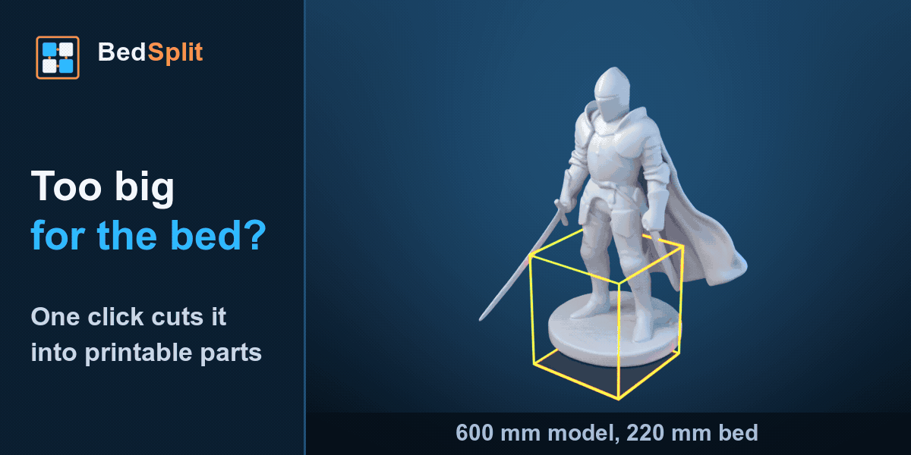
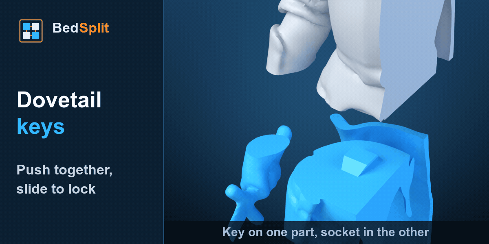
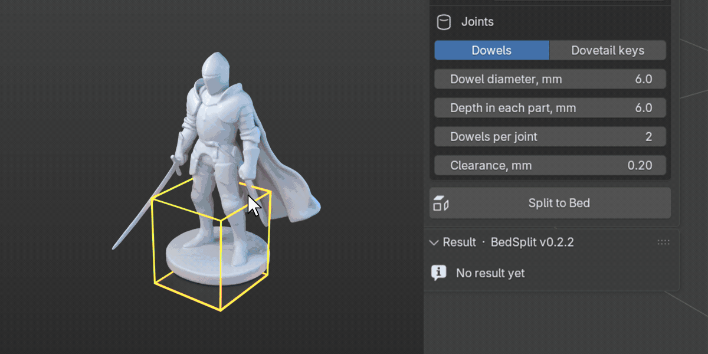
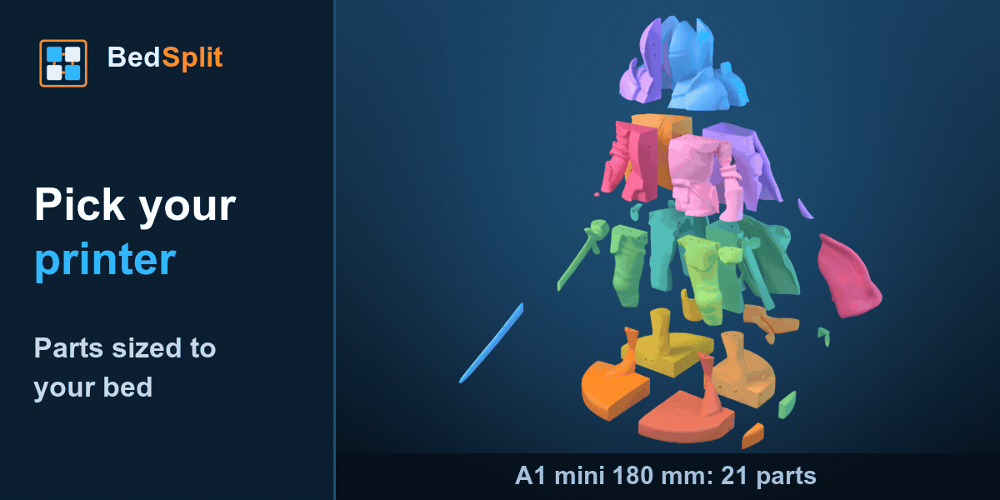
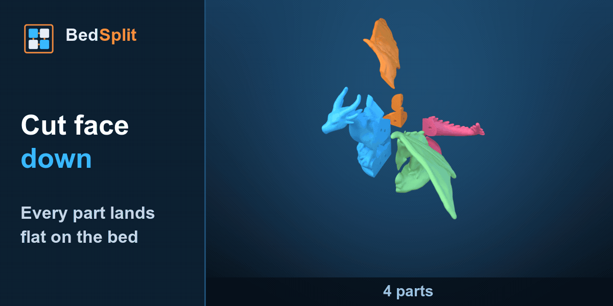
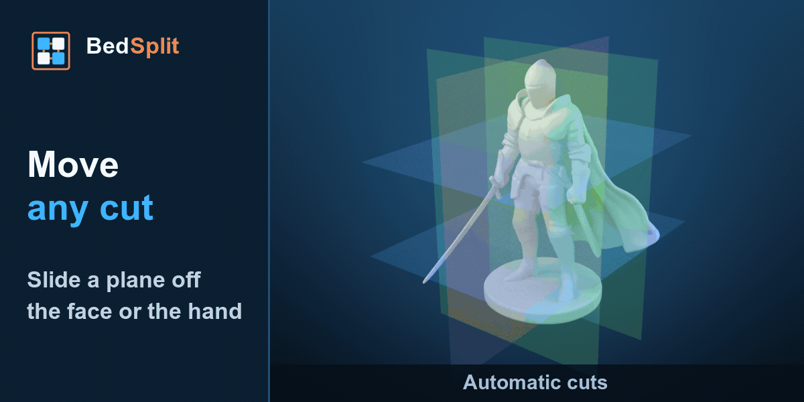
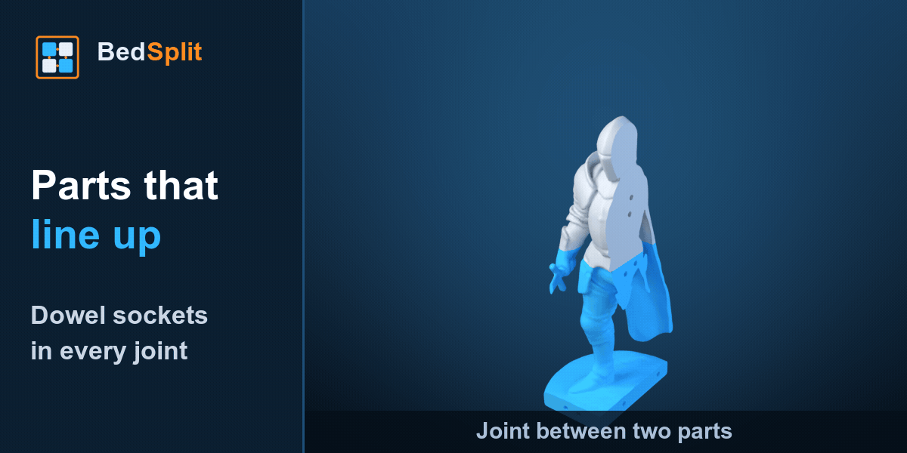
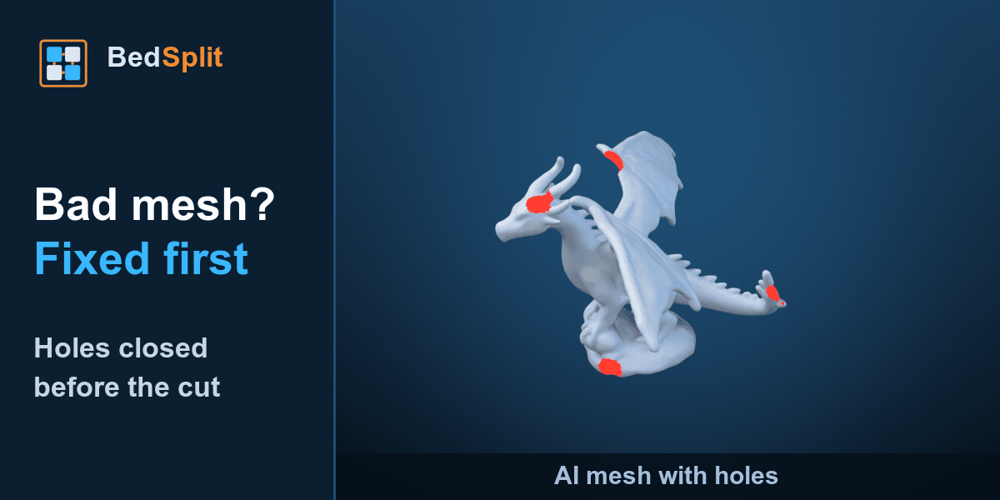

> The manual has moved to https://mendboxstudio.com/docs/bedsplit

# BedSplit 0.2.2: user manual

*Manual for BedSplit 0.2.2 (Blender add-on). Trailer: <https://youtu.be/-EbloCRxfUs>*

Buy: [Superhive](https://superhivemarket.com/products/bedsplit) | [Gumroad](https://mendbox.gumroad.com/l/bedsplit) | Free Lite version: [GitHub](https://github.com/mendbox/bedsplit-lite)

**Contents:** [1 What it does](#1-what-it-does) | [2 Install](#2-requirements-and-installation) | [3 Quick start](#3-quick-start) | [4 Reference](#4-reference-every-panel-button-and-setting) | [5 Worked examples](#5-worked-examples) | [6 Troubleshooting](#6-troubleshooting) | [7 Limitations](#7-known-limitations) | [8 Glossary](#8-glossary) | [9 FAQ](#9-faq) | [10 Support and changelog](#10-support-compatibility-and-changelog)

---

## 1. What it does

BedSplit cuts a 3D model into parts that fit the print bed (the flat plate) of your 3D printer. It repairs the model first, adds a joint to every cut so the parts line up (round dowel sockets, holes for little pegs, or interlocking dovetail keys), lays each part flat, and exports one STL file per part plus the dowels if you use them. You choose your printer, press **Split to Bed**, and print.

**Who it is for**

- Cosplay and prop makers: helmets, armor and swords bigger than the build plate.
- People who print statues, busts, figurines and terrain in several parts.
- Owners of small printers (180 mm and 220 mm beds) who want large prints.
- Anyone who prints AI-generated models (Meshy, Tripo, Hunyuan3D) at real size. Those meshes are often broken, and BedSplit repairs them first.

It is made for FDM printers (the common kind that melts plastic filament).

---

### Dovetail keys

Since version 0.2 you can join the parts with interlocking dovetail keys instead of dowels: a key on one part and a socket in the other, so there is nothing loose to print. Push the parts together and slide until the key stops. The clearance is 0.2 mm by default and you can change it. The keys are printed as part of the parts, with no supports needed for the key or the socket. On a part that has no flat side to stand on, BedSplit uses dowels on that cut instead and says so in the Result panel.

## 2. Requirements and installation

**Requirements**

- Blender 4.2 or newer (4.2 LTS, 4.5 LTS and 5.x). It is a Blender *extension*.
- No internet and no extra software.
- The add-on is a **.zip** file. **Do not unzip it.**
- The manifest asks for one permission: to write files, used only by **Export STL**.

**Install from disk**

1. In Blender open **Edit > Preferences** (Mac: `Cmd+,`).
2. Click **Get Extensions** in the left list.
3. Click the small arrow (v) menu in the top-right corner and choose **Install from Disk...**
4. Pick the BedSplit `.zip` file.
5. The extension turns on. If its checkbox is not ticked, tick it.

**Where is the panel?**

1. Hover the mouse over the 3D viewport. Be in **Object Mode** (the panel only shows in Object Mode).
2. Press `N` to open the sidebar.
3. Click the tab named **BedSplit** (written vertically at the right edge).
4. There are two panels: **BedSplit** (settings and the Split button) and **Result  ·  BedSplit v0.2.2** below it.

If no mesh is selected the panel shows "Select a mesh object".

**Update to a new version**

1. Download the new zip.
2. **Install from Disk** again. Blender replaces the old version.
3. Restart Blender if the version in the Result panel header does not change.

**Uninstall**

**Edit > Preferences > Get Extensions**, find BedSplit, open the arrow next to it and choose **Uninstall**. Parts you already created stay in your file as normal objects (in the collection "BedSplit - <model name>").

**Lite or full?**

| | BedSplit Lite (free, GPL) | BedSplit (full) |
|---|---|---|
| Panel tab name | BedSplit Lite | BedSplit |
| 18 printer presets and Custom size | yes | yes |
| Resize for print | yes | yes |
| Split to Bed (automatic flat cuts, closed parts) | yes | yes |
| Parts laid flat, per-part STL export, undo | yes | yes |
| Dowels and sockets (diameter, depth, clearance, dowels per joint) | no | yes |
| Dovetail keys (interlocking joints, nothing loose to print) | no | yes |
| Mesh repair (holes, flipped normals, overlapping shells, AI meshes) | no (closed meshes only) | yes |
| Find Cuts and movable cut planes | no (automatic cuts only) | yes |

---

## 3. Quick start

1. Import or open your model. Select it in **Object Mode**. A `.glb` import with an empty parent is fine: BedSplit finds the mesh under it.
2. Press `N`, open the **BedSplit** tab. In **Printer** choose your printer (for example Bambu Lab A1 / P1 / X1).
3. Look at **Model size**. If "Now" shows the wrong size, tick **Resize for print** and type the real size of the longest side in millimetres.
4. Press **Split to Bed**. The parts appear next to your model, flat, each in its own colour. The **Result** panel lists every part with a check mark.
5. Press **Export STL** and choose a folder. Print all part files, and the dowel file as many times as its name says.

---

## 4. Reference: every panel, button and setting

### 4.1 Panel "BedSplit"

#### Box "Printer"

| Control | What it does | When to use it | Default / range |
|---|---|---|---|
| **Printer** (dropdown) | The printable volume of your printer (width x depth x height, in mm). 18 presets, listed below, plus **Custom size**. | Always. Changing it clears the cut list. | Creality Ender 3 / V3 SE |
| **Bed** (three numbers) | Width, depth and print height in mm. Only shown when Printer is "Custom size". | If your printer is not in the list: look up the "build volume" in the printer's specifications. | 220 x 220 x 250, minimum 40 mm |
| "Bed: W x D x H mm" | Shows the volume in use. | | |

Printer presets (width x depth x height, mm):

| Printer | Bed |
|---|---|
| Bambu Lab A1 mini | 180 x 180 x 180 |
| Bambu Lab A1 / P1 / X1 | 256 x 256 x 256 |
| Bambu Lab H2D | 350 x 320 x 325 |
| Prusa MINI+ | 180 x 180 x 180 |
| Prusa MK4 / MK3 | 250 x 210 x 220 |
| Prusa XL | 360 x 360 x 360 |
| Prusa CORE One | 250 x 220 x 270 |
| Creality Ender 3 / V3 SE | 220 x 220 x 250 |
| Creality K1 | 220 x 220 x 250 |
| Creality K1 Max | 300 x 300 x 300 |
| Creality Ender 5 Plus | 350 x 350 x 400 |
| Anycubic Kobra 2 | 220 x 220 x 250 |
| Anycubic Kobra 3 | 250 x 250 x 260 |
| Elegoo Neptune 4 | 225 x 225 x 265 |
| Elegoo Neptune 4 Max | 420 x 420 x 480 |
| Sovol SV06 | 220 x 220 x 250 |
| Voron 2.4 300 | 300 x 300 x 280 |
| Voron 0.2 | 120 x 120 x 120 |

The values are printable volumes taken from each printer's specifications and may differ from yours if you changed the printer. Use Custom size to set your own.

#### Box "Model size"

| Control | What it does | When to use it | Default / range |
|---|---|---|---|
| "Now: N mm longest side" | The current longest side of the selected model, in mm, as BedSplit reads it (scene units are respected). | Check this first. If it is wrong, the model is in the wrong scale. | - |
| **Resize for print** (checkbox) | Scales the parts so the longest side of the whole model equals the size below. Off: the model is printed at its current size. | Statues and figurines imported at an arbitrary size. STL files made in mm and imported as metres. | Off |
| **Longest side, mm** | The printed size of the longest side of the whole model. Greyed out when Resize is off. | Type 600 for a 60 cm statue. | 400, minimum 10 (slider up to 3000) |

How size is read: BedSplit measures the model in world space (position, rotation and scale of the object, and its modifiers, are included). **Cuts are always along the world X, Y and Z axes**, so a rotated model is cut along the world axes, not along its own axes. With Resize off, one Blender unit counts as 1 metre unless you changed the scene's unit scale.

#### Box "Cuts"

| Control | What it does | When to use it | Default / range |
|---|---|---|---|
| **Find Cuts** (button) | Places the cut planes automatically for your printer and shows them in the viewport and as numbers in the panel. Reports "BedSplit: N cut(s)" or "the model fits the bed, no cut needed". | When you want to see or move the cuts before splitting. | - |
| **Show cuts in viewport** (checkbox) | Shows or hides the coloured planes. Moving a cut turns it back on. After a split the planes are hidden. | | On |
| Cut rows: **X / Y / Z** + number + x | Each row is one cut plane. The letter is the axis; the number is the distance in mm from the start of the model along that axis. Change the number to move the cut. The x button removes the cut. | Move a cut away from a face or a hand, or remove one. | 0 to 2000 mm |
| **Add cut: X Y Z** (buttons) | Adds a cut across that axis, in the middle of the largest remaining piece. | Add a cut where the automatic ones are not enough. | - |
| Hint "Automatic" | No cut list yet. Split will find the cuts itself. | | |
| Hint "No cuts: model fits the bed" | The model already fits. | | |

If you have a cut list, **Split to Bed** uses exactly those cuts. Removing every cut returns to "Automatic". Changing the printer, bed size or the Resize settings clears the cut list, because the cuts no longer match.

#### Box "Joints"

The row **Dowels | Dovetail keys** chooses the joint used on every cut. The settings of the chosen joint show below it. **Clearance** is shared by both.

| Control | What it does | When to use it | Default / range |
|---|---|---|---|
| **Dowel diameter, mm** (Dowels) | Thickness of the round peg. | Thicker for big parts. | 6.0, range 2 to 20 |
| **Depth in each part, mm** (Dowels) | How deep the socket goes into each part. The dowel is twice this long. | | 6.0, range 2 to 30 |
| **Dowels per joint** (Dowels) | The largest number of dowels placed on one cut face. | More dowels for big faces. | 2, range 1 to 3 |
| **Keys per joint** (Dovetail keys) | The largest number of keys on one cut face. | | 2, range 1 to 3 |
| **Size from cut face** (Dovetail keys) | On: the key width is 6 to 12 mm, the largest that fits the cut face. Off: you type **Key width, mm** and **Key height, mm**. The key is 1.5 times as long as it is wide, the socket 3 times. | Turn off to force one size on all keys. | On |
| **Angle** (Dovetail keys) | Slope of the key sides. More angle holds better and leaves a thinner neck. | | 20, range 10 to 30 |
| **Clearance, mm** (both) | Gap between dowel or key and its socket. 0.2 suits most printers. Raise it if the parts do not go together, lower it if they are loose. | Test with one small joint first. | 0.20, range 0 to 1 |

A dowel socket is placed only where the wall around it is thick enough: about 1.6 mm of material around each socket plus the clearance. With the defaults a cut section needs to be roughly 10 mm wide at that spot. Joints where it does not fit get no dowel and the Result panel tells you ("glue these").

**Dovetail keys.** A dovetail tail is part of the part below a cut and a keyhole socket is in the part above it. Nothing loose is printed. Push the two parts together, then slide one along the key until it stops: the joint holds against pulling apart. The keys are printed as part of the parts, with no supports needed for the key or the socket. The clearance (0.2 mm by default, adjustable) is the gap between key and socket. With cuts in more than one direction, join one direction at a time (all X joints, then Y, then Z). A drop of glue keeps the joint from sliding back.

**Mixing joints.** After **Find Cuts** each cut row has a menu **Auto / Dowel / Key**. Auto uses the joint chosen in the box Joints; set a cut to Dowel or Key to use that joint on this cut only.

**When a key is not possible.** A part that carries a key stands the way it stands in the model, so the key prints without supports. If a part has no flat side to stand on (a ball, a figure without a flat base), BedSplit puts dowels on that cut instead of keys, lays the part on a cut face, and says so in the Result panel. A cut you set to Key by hand keeps its key and shows a warning. A key needs room: the cut face must be about 22 x 11 mm at least. Smaller faces get no key and the panel names these joints.

#### The big button

| Control | What it does |
|---|---|
| **Split to Bed** | Repairs the model, cuts it into parts that fit the printer, adds the joints (dowel sockets or dovetail keys), and creates the parts as new objects. Your original model is **not changed**. Works in Object Mode with a mesh selected. |

What you get:

- A collection "BedSplit - <model name>" next to your model. If you split the same model again, the previous result for it is replaced.
- Parts named "<model> part 01", "part 02"... laid out in a grid beside the original, each turned so its largest cut face lies flat on the ground. Viewport colours show each part (Solid mode).
- With dowels: one extra object "<model> dowel xN", the dowel, to print N times. With dovetail keys there is nothing extra to print.
- The new parts are selected. The original stays active so the panel keeps working on it.

### 4.2 Panel "Result  ·  BedSplit v0.2.2"

| Item | Meaning |
|---|---|
| "No result yet" | You have not split anything in this file. |
| "N parts, M dowels" + check or warning icon | Totals. A check mark means all checks passed. |
| "<model>, T s" | Which model and how long it took in seconds. |
| Messages (lines with an icon) | What was repaired and what needs attention (see section 6). |
| "Part K: W x D x H mm" with a check or a cross | Size of each part. Check = it fits the bed **and** is a closed solid. Cross = too big for the bed or not closed. |
| **Export STL** (button) | Choose a folder. One STL per part in millimetres, plus one dowel file whose name says how many to print (for example `statue_dowel_x45.stl`). Reports "N STL file(s) saved to <folder>". Greyed out until you split. |

STL files contain geometry only: no colours, textures or UVs.

---

## 5. Worked examples

### Example 1: A helmet for a 180 mm bed

1. Import the helmet. Select it in Object Mode.
2. Printer: **Bambu Lab A1 mini**.
3. Check "Now". If the helmet is 300 mm long, leave Resize off.
4. Press **Split to Bed**. Check that every part has a check mark.
5. **Export STL**, load the files in your slicer (PrusaSlicer, Bambu Studio, Cura). Print the dowels too.

### Example 2: A statue at 600 mm on a 220 mm printer

1. Import the statue (STL, OBJ or GLB).
2. Tick **Resize for print**, type **600** into **Longest side, mm**.
3. Printer: **Creality Ender 3 / V3 SE**.
4. Press **Find Cuts** to see the cut planes. Check that no cut goes through the face or a hand.
5. Press **Split to Bed**.

### Example 3: A printer that is not in the list

1. Find the printer's "build volume" in its specifications (width x depth x height in mm).
2. Printer: **Custom size**. Type the three numbers into **Bed**.
3. Split as usual. If your slicer needs some margin (skirt, brim), reduce the numbers by 5 to 10 mm.

### Example 4: Moving a cut off a face

1. Press **Find Cuts**. The planes appear.
2. Look from the front. If a plane crosses the face, change its number by a few millimetres (for example 198.9 to 190).
3. Press **Add cut** or the x button if needed.
4. Press **Split to Bed**. The cuts you edited are used exactly.

### Example 5: Test the dowel fit before a long print

1. Split your model as usual.
2. Print the smallest part of one joint and one dowel.
3. If the dowel does not go in, raise **Clearance** by 0.1 and split again. If it is loose, lower it by 0.05.
4. Then print all the parts with the final value.

### Example 6: Dovetail keys instead of dowels

1. Select the model, choose your printer, press **Find Cuts**.
2. In the box **Joints** click **Dovetail keys**. To use keys on one cut only, set that cut from **Auto** to **Key** instead.
3. Press **Split to Bed**. The Result panel shows how many keys were made and names any cut that got dowels instead.
4. Export STL and print the parts (no extra files to print). After printing, push two parts together and slide one until it stops. If they do not go together raise **Clearance** by 0.1 and split again.

### Example 7: A broken AI model

1. Import the Meshy, Tripo or Hunyuan3D model. Select it.
2. Press **Split to Bed**. The Result panel says "Repaired: holes closed, normals fixed", "overlapping shells joined" or "surface rebuilt".
3. If it says "Heavy repair: surface rebuilt, fine detail smoothed (X mm)", look at the parts. The shape moved by X mm in some places.

---

## 6. Troubleshooting

### 6.1 Messages you can see

| Message | Where | Meaning and fix |
|---|---|---|
| "Select a mesh object" (in the panel) | Panel | Select the model. Curves, empties or Edit Mode are not accepted. For a `.glb` import with several meshes, select one mesh. |
| Buttons are greyed out | Panel | You are not in Object Mode, or no single mesh is selected. |
| "The object has no faces" | Split, Find Cuts, Add cut | The mesh is empty. |
| "The object has no size" | Split, Find Cuts, Add cut | All points are in one place. |
| "The model is N mm long and needs about M parts. Turn on Resize for print and type the real size" | Find Cuts, Split | The model is far too big for the bed: the scale is wrong (typical: a model made in mm imported as metres). Tick Resize for print and type the real length. |
| "BedSplit: the model fits the bed, nothing to split. Add a cut to split it anyway" | Split | No cut is needed. Press Add cut X, Y or Z to split it anyway. |
| "BedSplit: the model fits the bed, no cut needed" | Find Cuts | Same, information. |
| "BedSplit: N cut(s)" | Find Cuts | Success. |
| "BedSplit: split failed (...). Move a cut plane and try again" | Split | The cut could not be completed. Move a cut by a few millimetres (Find Cuts, change a number) and press Split again. |
| "Repaired: holes closed, normals fixed" | Result | Light repair succeeded. Information. |
| "Repaired: overlapping shells joined" | Result | Overlapping parts were merged. Information. |
| "Repaired: surface rebuilt (within X mm)" | Result | The mesh was rebuilt; the shape moved by less than 0.5 mm. Information. |
| "Heavy repair: surface rebuilt, fine detail smoothed (X mm)" | Result | The mesh was too broken. It was rebuilt and fine detail is smoothed by X mm (more than 0.5 mm). Check the parts. If this is not acceptable, repair the model yourself first. |
| "N part(s) not watertight: move a cut plane and split again" | Result | A part is not a closed solid, so a slicer may complain. Move a cut a few millimetres (Find Cuts), split again. |
| "N part(s) larger than the bed: add a cut plane" | Result | A part does not fit. Add a cut (Add cut X, Y or Z) or move cuts, and split again. |
| "N joint(s) without dowel (wall too thin): glue these" | Result | The cut face is too thin for a socket (under about 10 mm with default settings). Glue these joints flat, or move the cut to a thicker place. |
| "A dowel socket came out wrong: check the joints" | Result | A socket overlaps something or has the wrong gap. Look at the joints, try a different cut position. |
| "BedSplit: N parts, M dowels" | Status bar | Summary of a split. Notes are added after it when something needs attention. |
| "BedSplit: choose a folder" | Export STL | Pick a folder in the file window. |
| "BedSplit: cannot write the files (...)" | Export STL | The folder is not writable. Choose another one. |
| "BedSplit: N STL file(s) saved to <folder>" | Export STL | Success. |

### 6.2 Things that look wrong

| Symptom | Cause | Fix |
|---|---|---|
| The parts are tiny / huge | Wrong scale. | Use Resize for print. Check "Now: N mm longest side". |
| Cuts go through the face | The automatic cut chose that place. | Find Cuts, change the number, Split. |
| I cannot see the cut planes after splitting | They are hidden after a split. | Tick Show cuts in viewport, or edit a cut number, or press Find Cuts. |
| Part is marked with a cross | Too big for the bed or not closed. | See the messages above. |
| Dowels do not go in | Printer tolerance. | Raise Clearance by 0.1 and split again. |
| Dowels are loose | Clearance too big. | Lower Clearance. |
| Split is slow | Dense mesh. | The split takes from under a second to about 30 seconds on a dense mesh. Heavy repair is the slowest part. |
| Only some files were exported | Only objects of the last split result are exported. | Split again, then Export. |
| My parts moved when I moved the model | Parts are separate objects. | After moving the original, press Find Cuts again; planes are valid only for the model's current position. |
| Cut list disappeared | You changed the printer, bed or resize settings. | Press Find Cuts again. |
| Undo | | `Cmd+Z` / `Ctrl+Z` removes the split and keeps your edited cuts. |

---

## 7. Known limitations

- Cuts are flat planes along the world X, Y and Z axes. No curved cuts, no cuts along natural seams. You can move planes but not rotate them.
- Joints are round dowels or dovetail keys. No magnets, no snap-fit.
- A dovetail key needs room: the cut face must be about 22 x 11 mm at least (on side cuts at least 22 mm high). The key locks against pulling apart, not against sliding back: glue it or let gravity hold it.
- A part that carries a key cannot lie on that cut face. It stands the way it stands in the model, so its underside may need supports like the uncut model would.
- Thin walls (under about 10 mm at the joint with default settings) get no dowel; glue them.
- Heavily broken meshes are rebuilt with a voxel remesh. This closes them but smooths fine detail.
- No hollowing, no supports, no 3MF export. Made for FDM printing.
- STL files carry no colours, textures or UVs. The parts you see in Blender get plain viewport colours.
- Parts are laid out flat with the largest cut face down. If no cut face fits the bed that way, the part is just centred on the ground, and may be marked with a cross.

---

## 8. Glossary

- **Print bed / build plate:** the flat plate of the printer where the print is made.
- **Build volume:** the largest size the printer can print (width x depth x height).
- **FDM:** the printing method that melts plastic filament (most home printers).
- **STL:** a simple 3D file format made of triangles, used by slicers. Units are usually millimetres.
- **Slicer:** the program that turns a model into printer instructions (PrusaSlicer, Bambu Studio, Cura).
- **Dowel:** a small round peg that fits into sockets of two parts to line them up.
- **Socket:** the hole for the dowel.
- **Clearance:** the small gap between dowel (or key) and socket so the parts go together.
- **Dovetail key:** a wedge-shaped tail on one part that slides into a matching keyhole socket in the other and locks the joint against pulling apart.
- **Watertight / closed / manifold:** a mesh with no holes, like a sealed bottle. Slicers need this.
- **Non-manifold:** a mesh with holes, loose edges or edges shared by more than two faces.
- **Normals:** the direction each face points (outward on a good mesh). Flipped normals point inward.
- **Voxel remesh:** rebuilding a surface from tiny cubes. It closes a mesh but smooths detail.
- **Cut plane:** the flat imaginary sheet where the model is cut.
- **Joint:** the cut face where two parts meet.
- **Resize for print:** scaling the model to a real-world size.

---

## 9. FAQ

**Will every part fit my printer?** That is the point of Split to Bed: it picks the cuts so each part fits the width, depth and height you chose, and lays the parts flat. The Result panel shows a check mark per part. If you move cuts by hand and a part gets too big, the panel marks it.

**Does it work with AI-generated or broken meshes?** Yes. Holes, flipped normals, overlapping shells and non-manifold geometry are repaired before the cut. Very broken meshes are rebuilt with a voxel remesh, which smooths fine detail; the panel warns and shows how far the surface moved.

**What connectors does it make?** Your choice per split, or per cut: round dowels (a socket in both faces of each joint, and one dowel STL to print as many times as the file name says) or dovetail keys (a key on one part and a socket in the other, nothing loose to print).

**Can I choose where the cuts go?** Yes: Find Cuts, change numbers, add or remove cuts, split again.

**Which printer sizes are included?** 18 presets (see section 4.1). Or use Custom size.

**My STL is in millimetres but Blender shows it huge.** Tick Resize for print and type the real longest side.

**Can I print the original model without splitting?** Yes. If it fits, BedSplit says so.

**Does it change my model?** No. The parts are new objects in a new collection.

**How do I glue the parts?** Push the dowels in (or slide the keys together) (with a drop of glue if you like) and glue the cut faces with cyanoacrylate or epoxy. This is general 3D printing practice; BedSplit does not prescribe a glue.

**Does it work on Windows and Linux?** It is pure Python. Tested on macOS and Windows 11 (x86-64); Linux has not been tested.

**Do I get updates?** Free updates for the 0.x and 1.x line.

**Can I get a refund?** Refunds follow the store policy of where you bought it. Write to support first if something does not work.

---

## 10. Support, compatibility and changelog

**Support:** support@mendboxstudio.com. Include your Blender version, your operating system, the lines of the Result panel (copy the text), the printer you chose, and if possible the model or a small .blend that shows the problem.

**Compatibility, as tested:** the test suite passes on Blender **4.2.23, 4.5.14 and 5.2.2 on macOS and Windows 11 (x86-64)**. Exported parts were also checked by slicing them in PrusaSlicer.

**License:** GPL-3.0-or-later.

**Changelog**

| Version | Date | Change |
|---|---|---|
| 0.2.2 | 2026-11-18 | Fix: a cut exactly through vertices or edges of the model no longer loses volume; the Result reports an error if the volume check fails |
| 0.2.1 | 2026-11-18 | Dovetail keys print without supports; parts that cannot stand on a flat side get dowels on that cut and the Result says so; STL export of concave cut faces fixed |
| 0.2.0 | 2026-11-18 | Dovetail keys as an alternative to dowels, per-cut joint type, shared clearance |
| 0.1.3 | 2026-11-13 | First public release: 18 printer presets and Custom size, Resize for print, Find Cuts with movable cut planes, repair of broken meshes, dowels and sockets, parts laid flat, Result checks, Export STL |

There were no public releases before 0.1.3.
