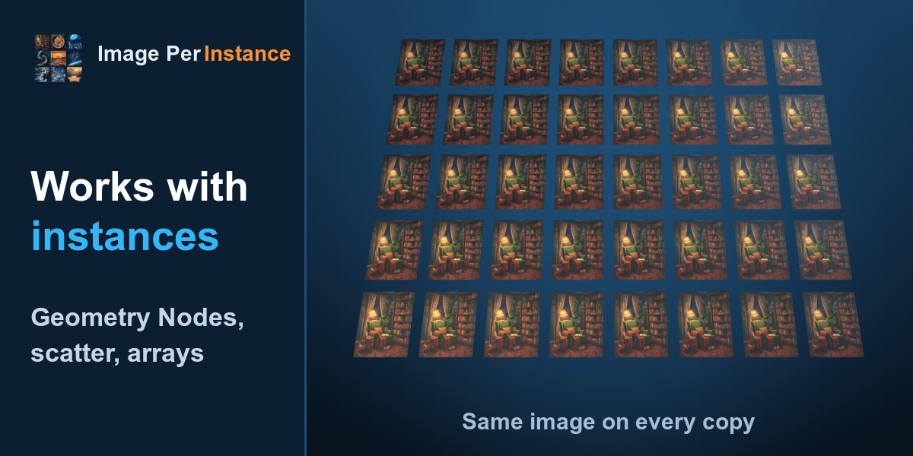
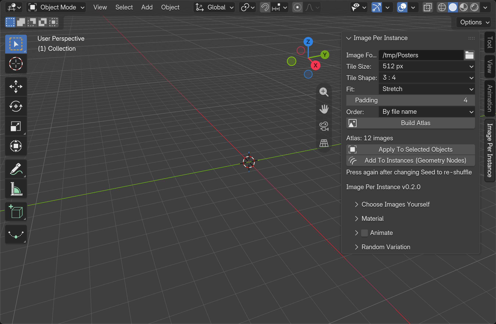
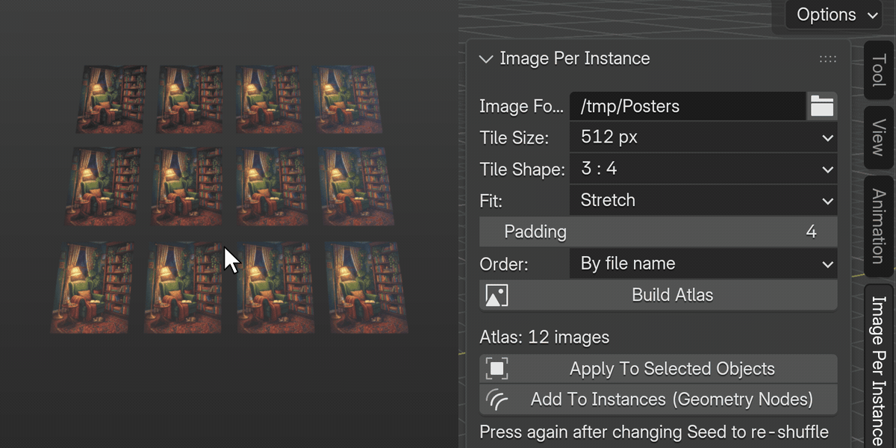
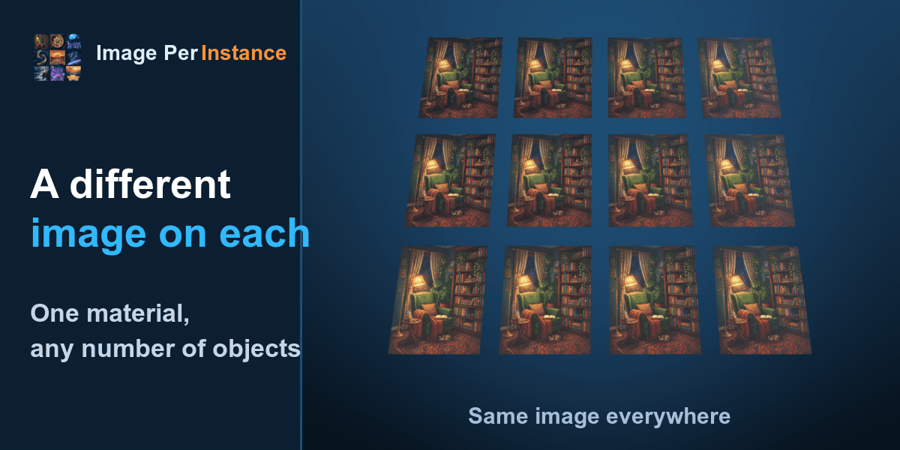
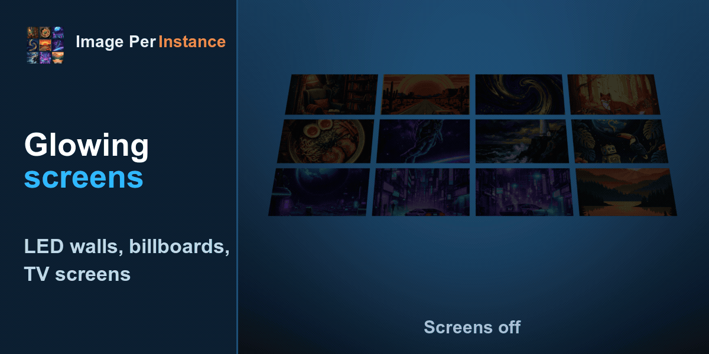
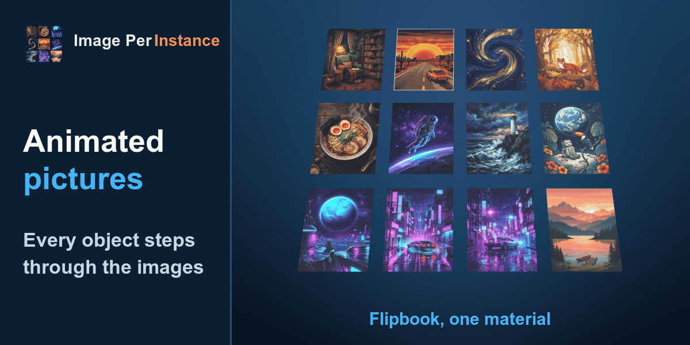
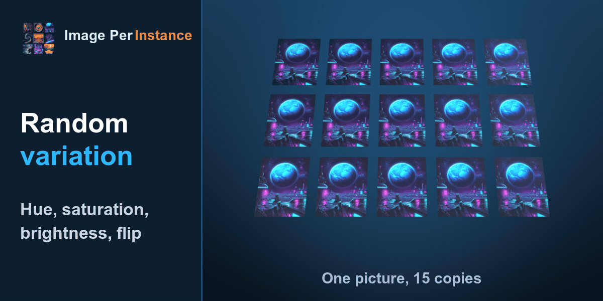

> The manual has moved to https://mendboxstudio.com/docs/image-per-instance

# Image Per Instance 0.2.0: user manual

*Manual for Image Per Instance 0.2.0 (Blender add-on). Trailer: <https://youtu.be/CLFAlI3Aa5c>*

Buy: [Superhive](https://superhivemarket.com/products/image-per-instance) | [Gumroad](https://quadfix.gumroad.com/l/image-per-instance) | Free Lite version: [GitHub](https://github.com/mendbox/image-per-instance-lite)

**Contents:** [1 What it does](#1-what-it-does) | [2 Install](#2-requirements-and-installation) | [3 Quick start](#3-quick-start) | [4 Reference](#4-reference-every-panel-button-and-setting) | [5 Worked examples](#5-worked-examples) | [6 Troubleshooting](#6-troubleshooting) | [7 Limitations](#7-known-limitations) | [8 Glossary](#8-glossary) | [9 FAQ](#9-faq) | [10 Support and changelog](#10-support-compatibility-and-changelog)

---

## 1. What it does

Image Per Instance puts a different picture on every object, array element or Geometry Nodes instance, using **one** material. You pick a folder of images, press **Build Atlas** (this packs all pictures into one big image), then give each object its own picture with one more button. No node trees to build by hand, no 100 copies of a material.

**Who it is for**

- Artists who make walls of posters, paintings or photo frames, book shelves, card collections, tiles, stamps, packaging.
- People who build LED walls, billboards and video-wall screens (emission and animation are built in).
- Anyone using **Instance on Points**, the **Array modifier** or many duplicated objects that must not all look the same.

---

## 2. Requirements and installation

**Requirements**

- Blender 4.2 or newer (4.2 LTS, 4.5 LTS and 5.x). It is a Blender *extension*.
- No internet and no extra software.
- The add-on is a **.zip** file. **Do not unzip it.**

**Install from disk**

1. In Blender open **Edit > Preferences** (Mac: `Cmd+,`).
2. Click **Get Extensions** in the left list.
3. Click the small arrow (v) menu in the top-right corner and choose **Install from Disk...**
4. Pick the Image Per Instance `.zip` file.
5. The extension turns on. If its checkbox in the list is not ticked, tick it.

**Where is the panel?**

1. Hover the mouse over the 3D viewport.
2. Press `N` to open the sidebar. Press `N` again to hide it.
3. Click the tab named **Image Per Instance** (written vertically at the right edge).
4. The main panel is **Image Per Instance**. Under it are four folded sub-panels: **Choose Images Yourself**, **Material**, **Animate**, **Random Variation**. Click a title to unfold it.

The panel works in Object Mode. The version number is shown at the bottom of the main panel ("Image Per Instance v0.2.0").

**Update to a new version**

1. Download the new zip.
2. **Install from Disk** again. Blender replaces the old version.
3. Restart Blender if the version number at the bottom of the panel did not change.

Your atlas, material and assigned pictures are stored in the .blend file and stay.

**Uninstall**

**Edit > Preferences > Get Extensions**, find Image Per Instance, open the arrow next to it and choose **Uninstall**. What stays in your .blend file: the atlas image `IPI_Atlas`, the material `IPI_Material`, the modifier "IPI Assign Index" and its node group `IPI_Assign_Index`, and a custom property `img_index` on the objects. They keep working without the add-on, but you cannot change the settings anymore. To remove them, delete the modifier and the material, then use **File > Clean Up > Purge Unused Data**.

**Lite or full?**

| | Lite (free, GPL) | Full |
|---|---|---|
| Panel tab name | Image Per Instance Lite | Image Per Instance |
| Build Atlas, Apply To Selected Objects, one shared material | yes | yes |
| Images per atlas | up to 20 | no limit (except the 16384 px atlas size) |
| Geometry Nodes instances (Add To Instances) | no | yes |
| Shuffle order | no | yes |
| Tile Shape, Fit modes | no | yes |
| Choose Images Yourself (Assign Image, Match By Object Name) | no | yes |
| Material options: alpha, emission, roughness, no-UV mapping | no | yes |
| Animate and Random Variation | no | yes |

This manual describes the full version. Lite is the first two lines of the table.

---

## 3. Quick start

1. Put your pictures in one folder (PNG, JPG, TIF, BMP, WebP, EXR, TGA). Name them in the order you like (`poster01.jpg`, `poster02.jpg`...).
2. In Blender add some planes (**Add > Mesh > Plane**). Duplicate them with `Shift+D`. Planes already have UVs that fill the picture.
3. Press `N`, open the **Image Per Instance** tab. Click the folder icon next to **Image Folder** and pick your folder.
4. Press **Build Atlas**. The panel now says "Atlas: N images".
5. Select all the planes and press **Apply To Selected Objects**. Switch the viewport to **Material Preview** (the third sphere icon at the top right of the viewport) to see the pictures.

For Geometry Nodes instances or the Array modifier: make the object that carries the modifier **active** and press **Add To Instances (Geometry Nodes)** instead of step 5 (see Example 2).

---

## 4. Reference: every panel, button and setting

### 4.1 Main panel "Image Per Instance"

Controls in the order they appear.

| Control | What it does | When to use it | Default / range |
|---|---|---|---|
| **Image Folder** | The folder with your pictures. Only files directly in the folder are used (not subfolders). Types: .png .jpg .jpeg .tif .tiff .bmp .webp .exr .tga. Order is "natural": `img2` comes before `img10`. | Always first. | empty |
| **Tile Size** | Size of one picture cell in the atlas, in pixels: 128, 256, 512, 1024 or 2048. For non-square tiles, this is the length of the longer side. Bigger = sharper pictures, bigger atlas. | 512 is fine for most scenes. Use 1024 or 2048 for close-ups with few images. | 512 px |
| **Tile Shape** | Shape of one cell: 1:1, 2:3, 3:2, 3:4, 4:3, 16:9, 9:16. | Pick the shape of your objects: 2:3 for posters and book covers, 16:9 for screens. | 1:1 |
| **Fit** | What to do when a picture has a different shape than the tile. **Stretch**: fill the tile, distort the picture. **Fit (bars)**: the whole picture visible, bars around it. **Fill (crop)**: the tile is fully covered, the picture edges are cut off. | Stretch for matching shapes. Fit to keep pictures complete. Fill to cover the tile without distortion. | Stretch |
| **Bar Colour** | Colour of the bars in Fit mode. Only shown when Fit is "Fit (bars)". Include transparency (alpha) to cut the bars away with *Use Image Alpha*. | Black bars for screens, white for paper. | black, opaque |
| **Padding** | Edge padding around each tile in pixels. It stops a tile from showing a thin line of its neighbour. | Raise it if you see colour bleeding at edges, especially on small tiles. | 4, range 0 to 32 |
| **Order** | **By file name**: object number 1 gets picture 1 and so on. **Shuffle**: every picture is used once before any repeat, in a scrambled order. The atlas itself is always in file-name order. | Shuffle to avoid obvious sequences. | By file name |
| **Seed** | Number that picks the shuffle arrangement. Only shown when Order is Shuffle. | Change it, then press Apply / Add To Instances again for another arrangement. | 1 |
| **Build Atlas** (button) | Packs all pictures into one atlas image stored inside the .blend, creates the shared material `IPI_Material` and updates it. Reports "Atlas WxH px, N images". Pressing it again replaces the atlas and keeps each object's picture (matched by file name). | After choosing the folder, and again after you add, remove or replace pictures, or change tile size, shape, fit, padding. | - |
| "Atlas: N images" | Shows how many pictures the atlas holds ("Atlas: not built" before). | - | - |
| **Apply To Selected Objects** (button) | Gives every selected mesh object its own picture (sorted by object name; with Shuffle, scrambled by Seed). The material goes on **slot 1** of the object, other slots stay as they are. | Separate objects: duplicated planes, frames, books. | - |
| **Add To Instances (Geometry Nodes)** (button) | Make the object with your Array / Instance on Points modifier **active** first. Finds the instanced source objects automatically (selected meshes are added too), gives them the shared material and adds a modifier "IPI Assign Index" that stores a picture number for each instance. Pressing it again updates the modifier (for example after changing Seed). | Geometry Nodes instances, the Array modifier, collection instances. | - |
| Hint "Press again after changing Seed to re-shuffle" | Reminder. | | |

### 4.2 Sub-panel "Choose Images Yourself" (separate objects only)

| Control | What it does | When to use it | Default / range |
|---|---|---|---|
| **Image Number** | Number of the picture in the atlas (1 is the first file). | When you know the number. | 1, minimum 1 |
| **Image** (search box) | Pick a picture by file name. Type to search. Changing it moves Image Number and the other way round. | Easier than counting. | empty |
| **Assign Image To Selected** (button) | Every selected mesh object gets the chosen picture and the shared material. | Put one specific picture on one specific object. | - |
| **Match By Object Name** (button) | Each selected object gets the picture whose file name equals the object name (or is contained in it as a whole word). A plane called `poster_cat` gets `cat.png`. Blender's `.001` suffix is ignored. | Many named objects, such as `cover_dune`, `cover_emma`. | - |
| Hint "Separate objects only" | These two buttons do not work on Geometry Nodes instances. | | |

### 4.3 Sub-panel "Material"

These options change the shared material at once. No new build is needed.

| Control | What it does | When to use it | Default / range |
|---|---|---|---|
| **Mapping** | Where the picture sits on the object. **UV Map**: use the object's UVs (they must fill the whole 0 to 1 square). **Front (no UVs)**, **Top (no UVs)**, **Side (no UVs)**: project the picture from that direction across the whole object. | UV Map for planes and unwrapped covers. Front/Top/Side for boxes, books and imported objects without UVs. | UV Map |
| **Use Image Alpha** | PNG transparency cuts the shape out (stickers, round cards, and the bars in Fit mode). | Pictures with transparent areas. | Off |
| **Emissive (screen)** | The picture glows by itself. Good for LED walls, billboards and screens. | Screens and signs. | Off |
| **Strength** | Brightness of the glow. Only shown when Emissive is on. | | 1.0, 0 and up (slider up to 10) |
| **Roughness** | How rough or shiny the surface is. | 0.5 is matte-ish. Lower is glossy. | 0.5, range 0 to 1 |

### 4.4 Sub-panel "Animate" (checkbox in the header)

| Control | What it does | When to use it | Default / range |
|---|---|---|---|
| **Animate** (header checkbox) | Every object steps through the pictures over time. Each object starts at its own picture. | Slideshow walls, video-wall style screens, flip displays. | Off |
| **Frames Per Image** | How many animation frames each picture is shown. | 24 frames is one second at 24 fps. | 24, minimum 1 (slider up to 240) |

The animation follows the scene frame, so press **Play** in the timeline (or move the playhead) to see it.

### 4.5 Sub-panel "Random Variation"

| Control | What it does | When to use it | Default / range |
|---|---|---|---|
| **Hue** | Random shift of the colour tone for each object. | Make copies of the same pictures look different. | 0, range 0 to 1 |
| **Saturation** | Random change of colour intensity per object. | | 0, range 0 to 1 |
| **Brightness** | Random change of brightness per object. | | 0, range 0 to 1 |
| **Flip X** (toggle) | Mirrors a random half of the objects left to right. | Careful with text. | Off |
| **Flip Y** (toggle) | Mirrors a random half of the objects top to bottom. | | Off |

Each value at 0 means "no variation". The variation uses Blender's per-object random number, so it is stable.

### 4.6 What the add-on creates in your .blend file

- Image `IPI_Atlas` (packed into the file).
- Material `IPI_Material`.
- A custom property `img_index` on each object that got a picture.
- On the Instance/Array host object: a Geometry Nodes modifier "IPI Assign Index" (node group `IPI_Assign_Index` with inputs Image Count, Shuffle, Seed, Shuffle Step).

Tile size table (square tiles; the atlas is limited to 16384 px per side). This is the arithmetic limit; very large atlases need a lot of memory and were not tested.

| Tile size | Most images in one atlas |
|---|---|
| 128 px | 16384 |
| 256 px | 4096 |
| 512 px | 1024 |
| 1024 px | 256 |
| 2048 px | 64 |

---

## 5. Worked examples

### Example 1: Posters on a wall

1. Put 12 poster pictures (2:3 shape) in a folder.
2. Add a plane, scale it to the poster shape, duplicate it 11 times (`Shift+D`).
3. Panel: set the folder, **Tile Size** 1024, **Tile Shape** 2:3, **Fit** Fill (crop). Press **Build Atlas**.
4. Select all planes and press **Apply To Selected Objects**.
5. To place a picture by name, rename planes `cat`, `dog`... and press **Match By Object Name**.

### Example 2: A wall of frames with an Array modifier or Instance on Points

1. Make one frame object (with a flat picture area on material slot 1). Add the **Array** modifier or build an Instance on Points setup on a host object that instances it.
2. Build the atlas as in Example 1.
3. Make the **host object** active (the one with the modifier). Select the source frame too if the add-on cannot find it.
4. Press **Add To Instances (Geometry Nodes)**. The report names the objects that got the material.
5. Set **Order** to Shuffle, change **Seed**, press the button again for a new arrangement.

### Example 3: An LED video wall

1. Build the atlas with **Tile Shape** 16:9 and **Fit** Fit (bars) or Fill.
2. Apply to the screen planes.
3. Open **Material**: switch on **Emissive (screen)** and set **Strength** to about 2.
4. Open **Animate**, tick the checkbox, set **Frames Per Image** to 48. Press Play.
5. Render in Cycles or EEVEE.

### Example 4: Flipbook animation

1. Put the animation frames in the folder (`frame001.png`, `frame002.png`...).
2. Build the atlas, apply it to one plane.
3. In **Animate**, tick the box and set **Frames Per Image** to 1 (a new picture every frame) or 2.
4. Press Play in the timeline.

### Example 5: Many copies that do not look identical

1. After applying, open **Random Variation**.
2. Set **Hue** 0.1, **Saturation** 0.2, **Brightness** 0.2. Tick **Flip X** if your pictures have no text.
3. Every object now has its own colour variation. No rebuild needed.

---

## 6. Troubleshooting

### 6.1 Messages you can see

| Message | Meaning and fix |
|---|---|
| "Choose an image folder first (folder icon next to Image Folder)" | The folder field is empty. Click the folder icon and choose a folder. |
| "No images (png, jpg, tif, exr...) found in: <folder>" | The folder is wrong or has no supported images in it (subfolders are not searched). Check the path and the file types. |
| "Atlas would be WxH px (limit 16384). Use a smaller tile size or fewer images" | Too many pictures for the tile size. Choose a smaller Tile Size (see the table in 4.6) or use fewer images. |
| "Skipped <file>: <reason>" (warning) | A file could not be read. The tile stays black. Convert or re-save that file. |
| "Atlas WxH px, N images" | Success. |
| "Build the atlas first" | Press Build Atlas before applying. |
| "Select mesh objects" | Select at least one mesh object (not an empty or curve). |
| "N objects, M images" | Success. |
| "Make the object with your Array / Instance on Points modifier active" | Click the host object so it is the active one. |
| "Added (or Updated) index modifier on <object>. Material set on: <names>" | Success. |
| "...No instanced source found: select the source objects and press again" (warning) | The add-on could not find which objects are instanced. Select the source objects too, keep the host active, and press again. |
| "Image Number N is too high: the atlas has M images" | Lower the number. |
| "N objects now show image K: <name>" | Success. |
| "Press Build Atlas again: this file has no image names stored yet" | The file was made with an old version. Press Build Atlas once. |
| "No object name matches an image file name" | Rename the objects so they contain the picture name, or use Assign Image. |
| "Matched N of M objects. No image for: ..." | Some names did not match. They are listed. |
| (Lite only) "This free version supports up to 20 images (N found)" | Lite limit. Use fewer images or the full version. |

### 6.2 Things that look wrong

| Symptom | Cause | Fix |
|---|---|---|
| I do not see the pictures | The viewport is in Solid mode. | Switch to Material Preview or Rendered (icons at the top right of the viewport). |
| Every object shows the same picture | You pressed Build Atlas but not Apply, or the objects use another material. | Select the objects and press Apply To Selected Objects. For instances use Add To Instances. |
| The picture is stretched, tiny or cut off | The object's UVs do not fill the 0 to 1 square, or Fit does not match. | Fix the UVs, or set Mapping to Front/Top/Side. Try Fit or Fill instead of Stretch. Set Tile Shape to the shape of the object. |
| The picture is upside down or mirrored | UV orientation, or Flip X/Y is on. | Turn Flip off. Rotate the UVs 180 degrees. |
| A box shows streaks on the sides | Front/Top/Side is one flat projection, not triplanar. | Use a UV map for objects that face several directions. |
| Thin lines of a neighbour picture at the edges | Not enough padding. | Raise Padding and press Build Atlas. |
| Pictures look too dark or too bright | Colour space of the source. 16-bit PNG and EXR are converted correctly in 0.2.0. | Update to 0.2.0. Check the image. |
| Instances still all look the same | The host object is not active, or the instance source has another material. | Press Add To Instances again with the host active; check the report which source objects got the material. |
| The pictures changed order after I added files | Files are in natural name order. | Name files in the order you want. Existing objects keep their picture by file name. |
| The .blend file became large | The atlas is packed into the file. | Use a smaller Tile Size, fewer pictures, or a smaller atlas. |
| Animation does not move | Animate is off, the timeline is not playing, or you only have one picture. | Tick Animate, press Play. |
| Changing Seed does nothing | The seed is read when you press the Apply buttons. | Press Apply To Selected Objects or Add To Instances again. |
| Image Per Instance and Cycles/EEVEE | Tests were run on rendered colours in Cycles. | If EEVEE looks different, report it with a small .blend. |

---

## 7. Known limitations

- One atlas per .blend. Pressing Build Atlas again replaces it.
- Two files with the same name and a different extension (`cat.png` and `cat.jpg`) show as one name in the picker. Image Number still reaches both.
- Front / Top / Side mapping is one flat projection, not triplanar. Faces that point in other directions get a stretched streak.
- The atlas is limited to 16384 px per side.
- For small image counts the Shuffle order has a visible rhythm (it spreads pictures evenly, it is not true random).
- The picture goes on material slot 1 of the object. Other slots are not touched.
- Assign Image and Match By Object Name work on separate objects, not on instances.
- Not a replacement for UDIM tiles or texture painting.
- Material changes are tested on rendered colours; the viewport in Solid mode does not show pictures.

---

## 8. Glossary

- **Atlas:** one big image that contains many small pictures in a grid, like a contact sheet. Here it is stored inside your .blend.
- **Tile / cell:** one picture's square (or rectangle) inside the atlas.
- **Instance:** a copy of an object made by Geometry Nodes (Instance on Points) or the Array modifier. Instances share their source's mesh and material.
- **Geometry Nodes:** Blender's node-based system for procedural geometry.
- **Array modifier:** makes repeated copies of an object.
- **UV map:** the 2D coordinates that tell a mesh where on a picture each point sits. The picture's area is the 0 to 1 square.
- **Material slot:** one of the material entries of an object (slot 1 is the first).
- **Emission:** light that a surface gives off by itself.
- **Alpha:** transparency of a pixel.
- **Padding:** extra border pixels around a tile.
- **Seed:** a number that picks one random arrangement. Same seed, same result.
- **Shuffle:** every picture once before any repeat, in scrambled order.
- **Material Preview / Rendered:** viewport modes that show textures.
- **Cycles / EEVEE:** Blender's two render engines.

---

## 9. FAQ

**Why not UDIM tiles?** UDIM needs tile numbering, naming rules and per-object UV offsets. This add-on does the setup for you and also drives Geometry Nodes instances.

**Does it work with the new Array modifier?** Yes. Make the object active and press Add To Instances. If the Array source is an object the add-on finds it; if not, select the source objects too and press the button again.

**Will it change my original objects?** It adds the material to slot 1, a custom property on separate objects and one modifier on the instance host. You can remove all three.

**Does it need internet or extra software?** No.

**How many images can I use?** The full version has no image limit, only the 16384 px atlas size limit (see the table in 4.6). Lite has a limit of 20.

**What file types?** PNG, JPG, JPEG, TIF, TIFF, BMP, WebP, EXR, TGA. 16-bit and EXR are supported.

**Can I use different tile sizes for different images?** No. All images are resampled to one tile size and shape.

**Does it work in EEVEE and Cycles?** Yes. The tests render in Cycles; both engines use the same material.

**Does it work on Windows and Linux?** It is pure Python. Tested on macOS only (see section 10).

**Can I animate it?** Yes, in the Animate sub-panel.

**Do I get updates?** Free updates for the 0.x and 1.x line.

**Can I get a refund?** Refunds follow the store policy of where you bought it. Write to support first if something does not work.

---

## 10. Support, compatibility and changelog

**Support:** support@dynamicflower.pt. Include your Blender version, your operating system, the message from the status bar, and if possible a small .blend file and two or three sample images.

**Compatibility, as tested:** the automated tests pass on Blender **4.2.23, 4.5.14 and 5.2.2 on macOS**. They build the scene, apply the add-on and check the rendered colour of every tile (separate objects and Geometry Nodes instances), plus fit modes, assign and match by name, mapping without UVs, animation, variation, the shuffle order, empty-folder handling and multi-slot sources. The 0.2.0 build was also clicked through by hand in Blender (a 20-step checklist). Windows and Linux were **not** tested.

**License:** GPL-3.0-or-later.

**Changelog**

| Version | Date | Change |
|---|---|---|
| 0.2.0 | 2026-11-10 | Tile shape and fit modes (bars / fill / stretch), Assign Image and Match By Object Name with image picker, material options (alpha, emission, roughness), mapping without UVs (Front / Top / Side), Animate, Random Variation, natural sort order, Build Atlas keeps each object's picture, 16-bit / EXR brightness fix, viewport redraw fix |
| 0.1.7 | 2026-10-03 | The picture goes only on material slot 1; other slots on the source object stay untouched |
| 0.1.6 | | Empty or wrong folder gives a clear error; version shown in the panel |
| 0.1.5 | | Shuffle never reverses the order |
| 0.1.4 | | Version number in the panel |
| 0.1.3 | | Shuffle spreads images instead of shifting them |
| 0.1.2 and earlier | | First working builds, Geometry Nodes instances, GUI test fixes |
